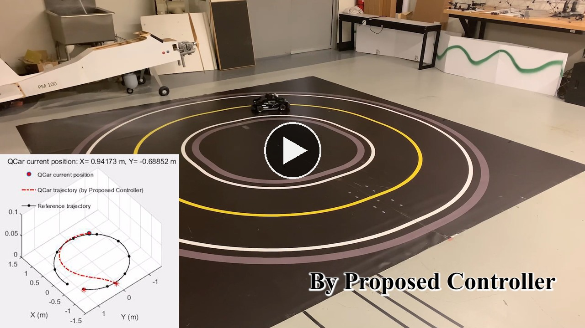
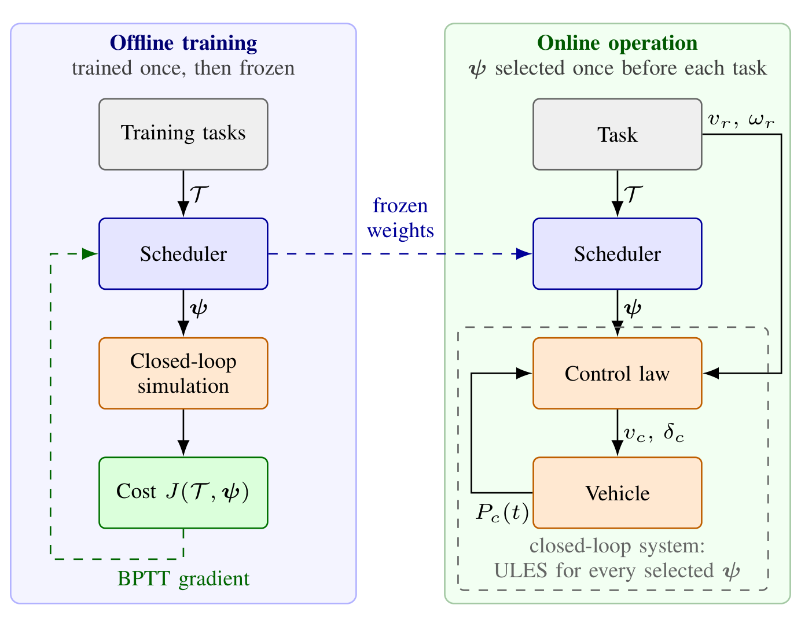
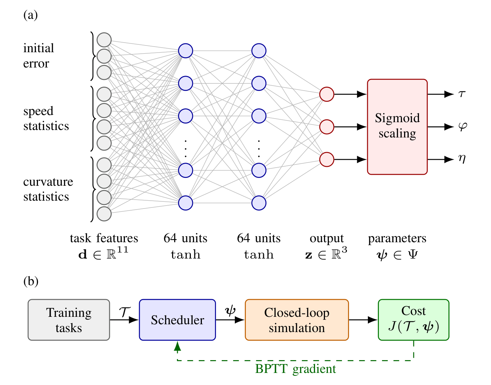

# Task-Level Neural Gain Scheduling for Lyapunov-Based Trajectory Tracking of Autonomous Vehicles

**Tianqi Yang** 
Faculty of Robot Science and Engineering, Northeastern University, Shenyang, China 
2310770@stu.neu.edu.cn

This repository hosts the experimental video of the paper *Task-Level Neural Gain Scheduling for Lyapunov-Based Trajectory Tracking of Autonomous Vehicles*.
The experiments are conducted on the QCar platform in two scenarios, and the proposed controller is compared with three existing controllers (Controllers A, B, and C in the paper).

Watch the video online: https://ytqconcordia-neu.github.io/task-level-gain-scheduling/

Download the full-quality video (1920x1080, 309 MB): https://github.com/ytqconcordia-NEU/task-level-gain-scheduling/releases/latest

## Contents of the video

| Time | Content |
|---|---|
| 0:15 | Scenario I, Controller A |
| 0:28 | Scenario I, Controller B |
| 0:40 | Scenario I, Controller C |
| 0:52 | Scenario I, proposed controller |
| 1:04 | Localization of the vehicle (LiDAR and IMU) |
| 1:09 | Scenario I, comparison of the four controllers |
| 1:23 | Scenario II, Controller A |
| 1:43 | Scenario II, Controller B |
| 2:03 | Scenario II, Controller C |
| 2:23 | Scenario II, proposed controller |
| 2:42 | Scenario II, comparison of the four controllers |

## Method

Before each task, a neural network maps the initial tracking error and the features of the reference trajectory to the three parameters of a backstepping control law, which remain constant during the task.
The neural network is trained without labeled data by backpropagation through time (BPTT), and the output layer restricts the parameters to a bounded admissible set.

Left: Architecture of the proposed task-level neural gain scheduling method. Right: Scheduler: (a) network structure, (b) training by BPTT.
